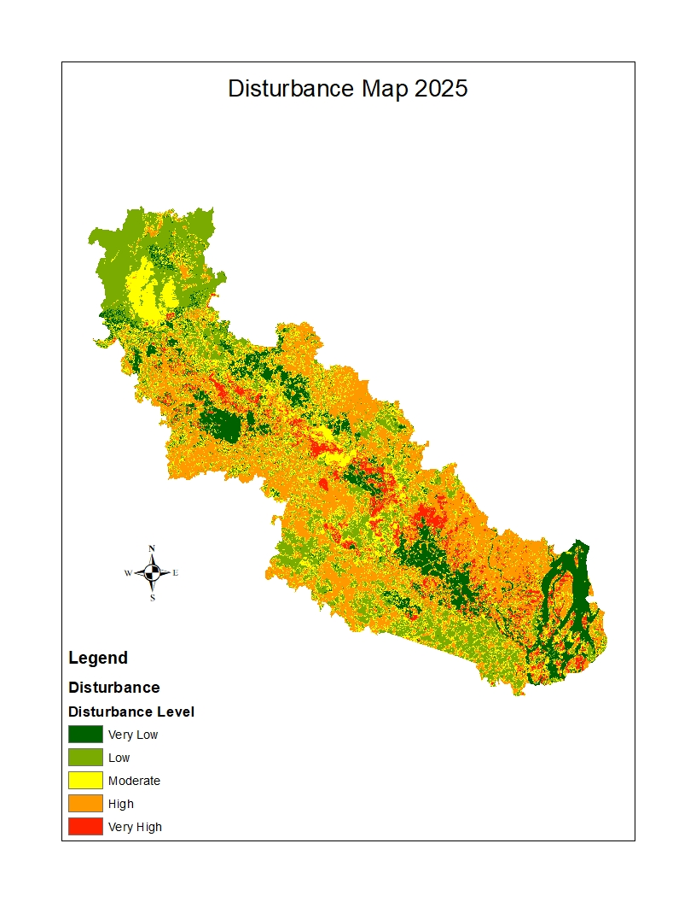
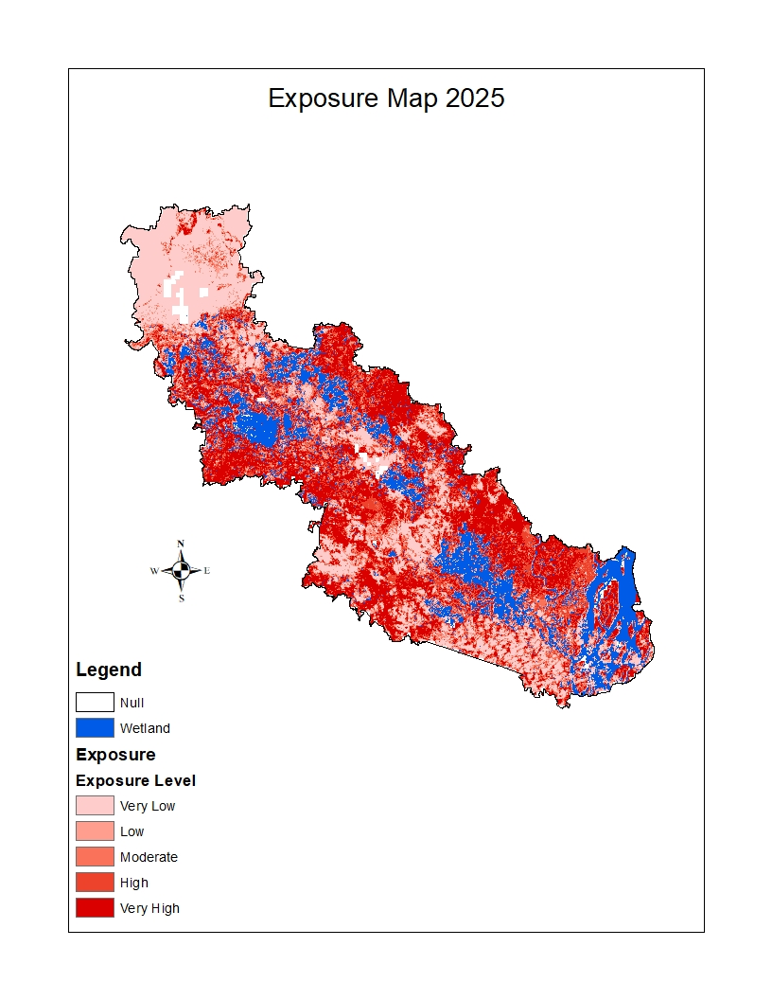
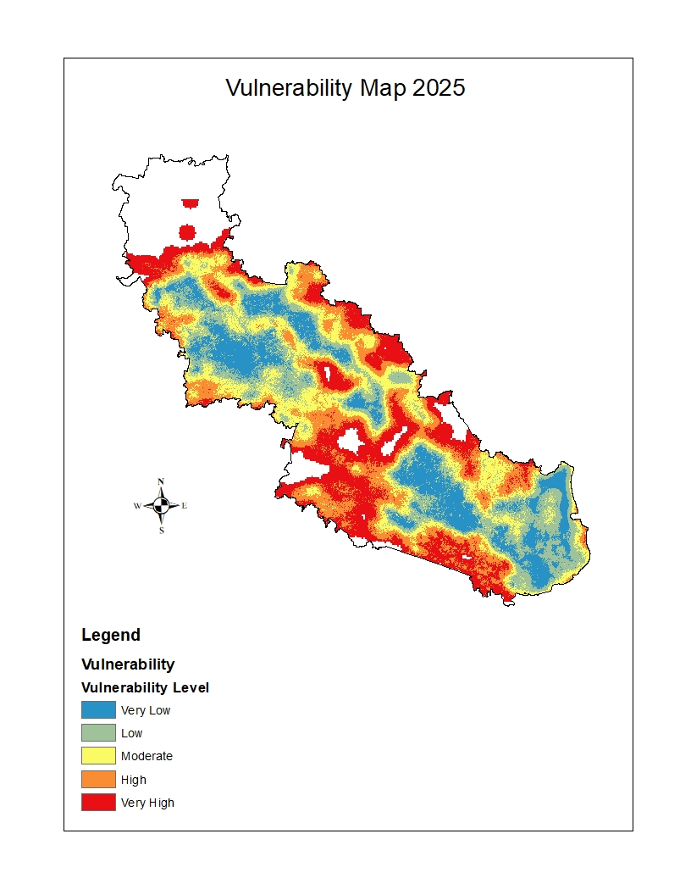
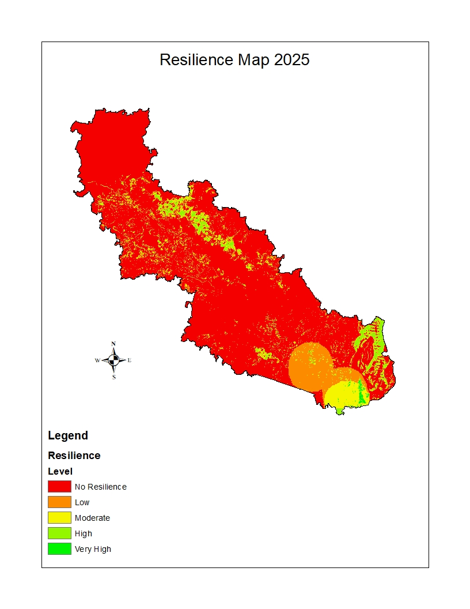

# Spatial Ecological Assessment of Chalan Beel

## Project Overview

This project presents a spatial assessment of ecological conditions across the Chalan Beel region of Bangladesh.

The assessment examines four components: disturbance, exposure, vulnerability, and resilience. These components provide a spatial understanding of ecological pressures and ecosystem conditions.

## Study Area

**Chalan Beel, Bangladesh**

## Assessment Components

### 1. Disturbance Assessment
Spatial representation of ecological disturbances across the study area.

### 2. Exposure Assessment
Spatial distribution of areas exposed to ecological pressures.

### 3. Vulnerability Assessment
Identification of areas with varying levels of ecological vulnerability.

### 4. Resilience Assessment
Spatial assessment of ecological resilience across the study area.

---

# Spatial Assessment Maps

## Disturbance Map

## Exposure Map

## Vulnerability Map

## Resilience Map

---

## Tools Used

- ArcMap
- Google Earth Engine
- Microsoft Excel

## Project Outputs

- Disturbance Map
- Exposure Map
- Vulnerability Map
- Resilience Map

## Author

**Gourab Halder**

B.Sc. in Urban and Regional Planning  
Rajshahi University of Engineering & Technology (RUET)  
Rajshahi, Bangladesh
