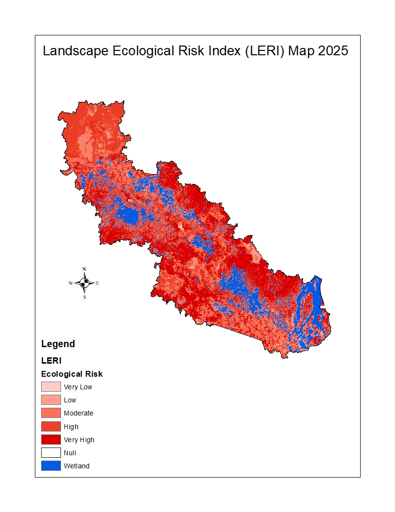
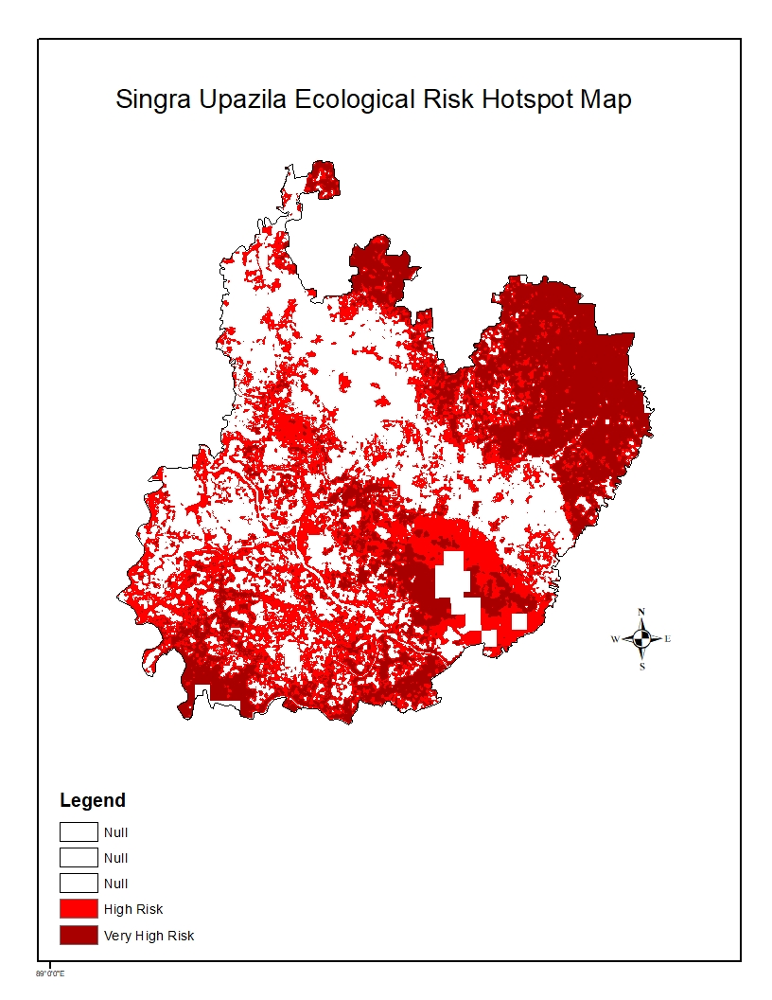
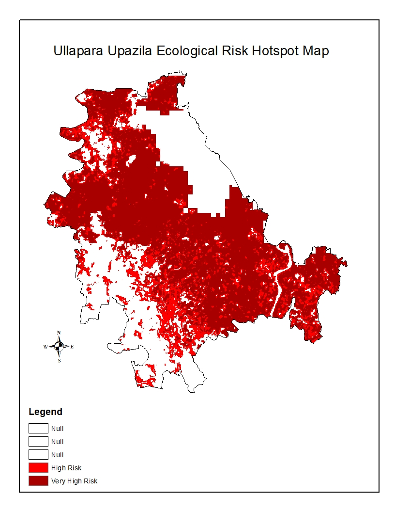
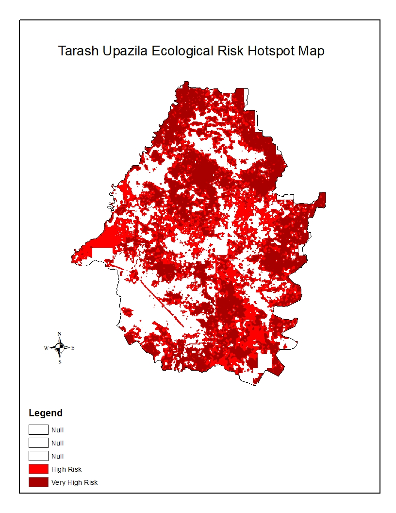
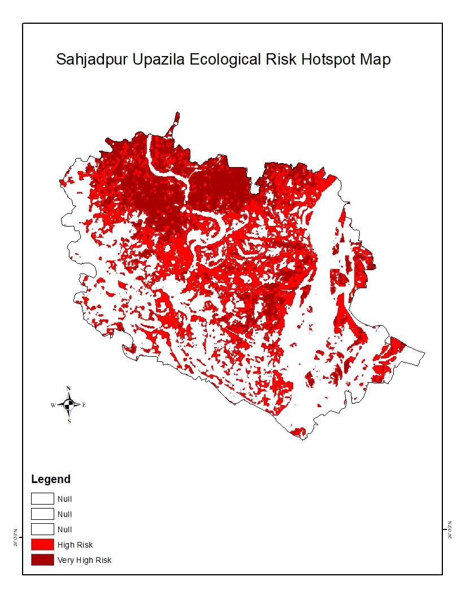
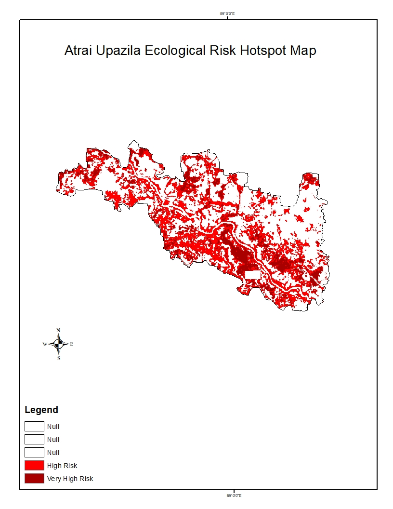
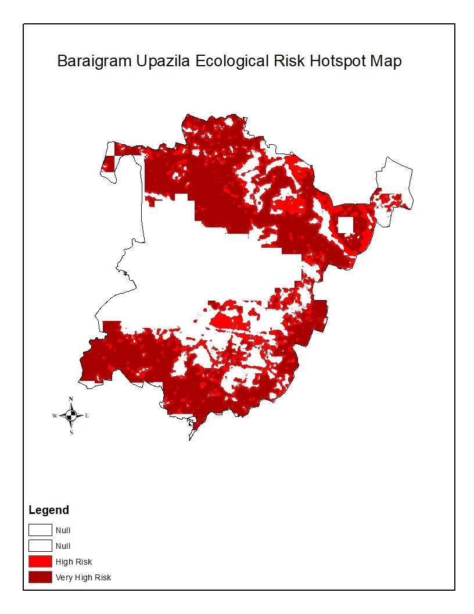

# Upazila-Wise Ecological Risk Assessment of Chalan Beel

## Project Overview

This project presents a spatial assessment of ecological risk across the Chalan Beel region of Bangladesh, with particular attention to upazila-level variations.

The analysis includes the Landscape Ecological Risk Index (LERI) map, an upazila-wise risk map, and individual ecological risk maps for eight major upazilas.

## Study Area

**Chalan Beel, Bangladesh**

## Assessment Outputs

1. Landscape Ecological Risk Index (LERI) Map
2. Upazila-Wise Ecological Risk Map
3. Individual Upazila Risk Maps for eight major upazilas

---

# Spatial Risk Maps

## 1. Landscape Ecological Risk Index (LERI)

## 2. Upazila-Wise Ecological Risk Distribution

---

# Individual Upazila Risk Assessment

## Singra

## Ullapara

## Chatmohar

## Tarash

## Shahjadpur

## Gurudaspur

## Atrai

## Baraigram

---

## Key Findings

The thesis-based ecological risk assessment identified:

- Very High Risk: 1,116.11 km² (30.61%)
- High Risk: 1,065.46 km² (29.22%)
- Moderate Risk: 853.59 km² (23.41%)

Very High and High risk areas together accounted for 59.83% of the study area.

## Project Applications

- Identification of ecological risk hotspots.
- Upazila-level conservation prioritization.
- Wetland management and spatial planning.
- Support for local environmental decision-making.

## Tools Used

- ArcMap
- Google Earth Engine
- Microsoft Excel

## Author

**Gourab Halder**

B.Sc. in Urban and Regional Planning  
Rajshahi University of Engineering & Technology (RUET)  
Rajshahi, Bangladesh
